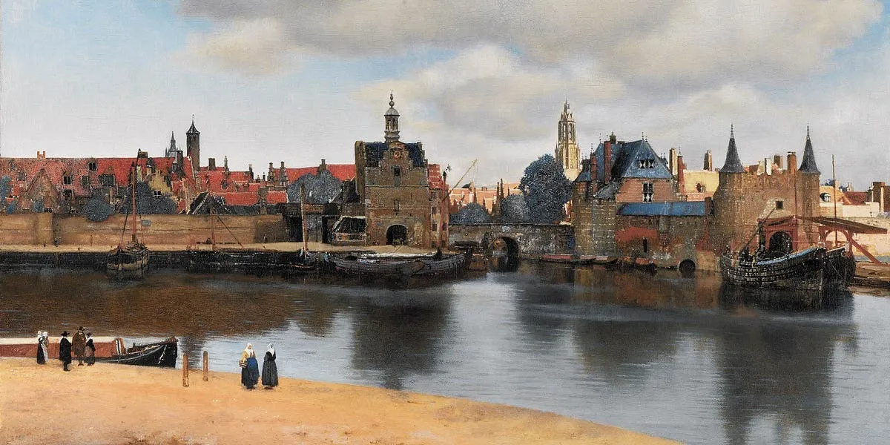

It is 23rd August today and just like every year, a day later I would be getting texts, calls and random greetings from people who I have probably not talked to in the past 1 year. The celebrations (if you do them) often take the real purpose of birthdays, at least in my opinion, away! "Birthdays are like a second new year" is what could be an alternative title for this post but that wouldn't have gotten you to read through this maybe.

Slowly growing up one of the things that I have looked forward to on my birthday was writing about how the past year has been, and no it isn't a summary or check list of things I accomplished, felt proud about and wanted to show off to my present self for motivation. I did that maybe for one or two years but eventually it dawns on you that all of these don't matter much in reality to introspect over, you will always accomplish newer things, have more fancy stuff to parade about with and strike off increasing amounts of to-do's from your bucket list (at least in the ideal scenario, you might miss a year or two in between on these and trust me it's not end of the world) but there is something of far more worth to optimise for and pen down to look back!

How do you think about the world around you? What impacts your thoughts the most? Was there any event in the past year that shaped you as you are now? Did your overall mental state change from a certain emotion to another and what was that inflection point? These are some of the questions that are more important for finding out the real "you" as a person, which automatically makes them harder to answer instantly. This activity almost forces you to sit down peacefully, dwindle down that memory lane of the past year which you in general avoid after those multiple unpleasant memories that still haunt you at times and come out with the actual gold of insights about your nature. The whole journey is quite fun in itself and probably doesn't need any more reasons for you to get started on it (a similar idea like one of my favourites from the old days -  [Journey To Ithaka](https://www.poetryfoundation.org/poems/51296/ithaka-56d22eef917ec)) but I really want you to set out on this voyage and in case you are not convinced yet here are some more: 

-  In the midst of your gradual recall, you remember a moment whose details faded on with time and you really relished it when it was happening but soon more memories piled up on top of it and you forgot the actual worth of the event. Remember there are a multitude of such reasons that make you grateful for whatever you have received and a conscious effort to write them down leaves you with a satisfied heart.
- People that you haven't talked to in the recent time but are special for you appear in the focus again and this provides with a nice opportunity to talk again!
- You get to create a chronological record of your thoughts, ideas, impressions and beliefs and how they evolve through time. I visualise this like seeing a potter carve out a jug by slowly giving it shape, except that the jug is your true self, the potter being the environment you are in, the people around you and the events in your life that push you out of your comfort zone, the only difference is there is no correct shape for the jug but only the detailings and clarity of work that sets apart one from another. Wouldn't this sort of representation in the future be something to look forward to!?
- You can be your own therapist (till a certain extent)! Answering such questions often resolves a lot of un dealt with emotions when you realise that often what you gained overall is more valuable than these tiny hiccups on the way. Personally I've had a lot of such realisations with just my meditations and this habit of writing things down
- Stop considering things as trivial, often when we grow personally quite a bit and people have trouble recognising this "new" you it starts to feel that all the work you put in to become this new version was nothing extraordinary and not something to feel happy about. This act of giving words to weird feelings makes you realise this again!

In short, extend your birthdays to something more than just greetings and parties, humans have a clever way of ignoring important aspects of their life just due to this lack of "opportunity" as an excuse, why waste one that you're naturally getting?

----

One of the things I've really wanted to do this year was being more open and public about a lot of aspects of my life, I've been writing a lot and who knows some of it might be helpful to a random person sitting on the other side of the planet. In any case this was an attempt at being more comfortable at this and hopefully it inspires you to close your favourite LLM for a while and write something of your own

P.S - I hope someone gets the context of having View of Delft here.
