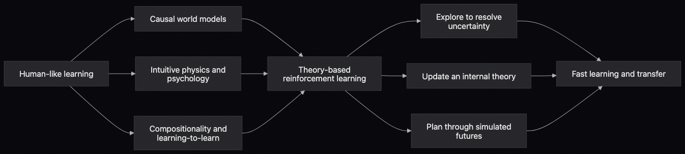
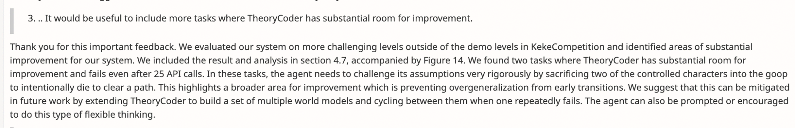

Recently [this](https://x.com/arcprize/status/2080716567760007317?s=20) tweet of Opus 5 beating a previously unbeaten game (ar25) through the use of seemingly emergent symbolic reasoning has been doing the rounds online, when I came across it, I was instantly reminded about [another](https://royalsocietypublishing.org/rsta/article/384/2320/20240529/481693/Human-level-learning-of-complex-novel-tasks-as) paper that I read a while back. What they suggest through a cognitive science perspective is representation of the game state, characters, rules, situations etc in VGDL (a symbolic language) and then performing Bayesian inference over the hypothesis space which leads to different learnable problem solving theories, unlike which Opus 5 does task specific symbolic abstractions on the fly depending on the environment.

An obvious question is why should you care and read this? I am pretty sure you hadn't heard of EMPA before and chances are you probably won't in the future too unless you stumble across it in some weird royal society issue but the point is you should! The idea is elegant and I am quite sure that all the problems/shortcomings I will describe here are either already resolved to a certain extent or are being worked upon. The results they show in the original paper are enough to reel you in, they compare EMPA with DDQN, Rainbow and even humans on 90 Atari style games, and against Rainbow, EfficientZero etc. over 5 Atari games with 21,000 frames to prove their point that it indeed does learn like humans and not just ends up competitively with them on a benchmark. A follow-up [paper](https://pubmed.ncbi.nlm.nih.gov/36898374/) of the same demonstrated that the neural activity found by performing an fMRI while the user played these Atari games were consistent with the theories predicted by the model.

Tenenbaum's lab has the broader manifesto of [Building Machines That Learn and Think Like People](https://arxiv.org/abs/1604.00289). Codex does a better job than me with the below visual graphic to explain this programme. To my knowledge, EMPA is the first practical attempt to combine all of these scattered ideas into an interactive agent and a big reason for which I hold it in high regards is the sheer breadth of ideas which it covers up that needed proper formalisation in the field and spawn a plethora of future work with them, albeit just like anything else not perfectly but sets a solid ground for future work to build upon.

---

## Theory based RL?

The main idea behind naming their approach "theory" based reinforcement learning stems from the age old debate of model free vs model based RL, here they specifically draw on cognitive science for inspiration and how humans from their childhood model their environment with its objects and the causal relationships between them in forms of "intuitive theories" which are used to plan future actions. A simple EMPA loop starts with this modelling of symbolic theory consisting of the existing objects, identification of the agent and target from them and which environment state qualifies as a victory or failure. After which it creates the best possible plan for the future action, executes it in the provided environment and updates its theory again. The exploration for the agent is driven by intrinsic motivation of reducing uncertainty about the world through learning new causal rules, suppose if there is no instance of interaction between object class c_i and c_j then it asks the planner to generate the next set of actions to exploit this condition specifically.

All of this formalisation is done through Bayesian inferencing for which it maintains a probability distribution of the possible game theories and updates it constantly after reflection on the consequences of the performed actions. The theory with highest probability is chosen and is used by the planner to simulate the sequence of actions to perform, the best possible sequence is then chosen to be executed in the environment and if the outcome from these differ from the predicted outcome, the planner is run again. I'll save you from the notations here and hope that you are motivated enough to check out the methodology (and whatever other details I missed) on your own.

On 90 Atari style GVGAI games provided in VGDL, EMPA remains within an order of magnitude of the humans performance on learning efficiency (defined in a metric based on the levels solved) in 79 games and was 1000x more efficient than DDQN in 45 games (another unfair comparison and one of the biggest gaps in the paper.. more on this in gaps)

---

## EMPA on ARC-AGI-3

Classically EMPA uses VGDL to represent the game state and basically everything needed for it to work upon, whereas ARC-AGI-3 provides colored grids instead of predefined symbolic objects, a single action in it can produce multiple frames to change, has a more diverse action space among other differences. To bridge both of these systems together the few changes are done while preserving the essential spirit of the exploration, modelling, planning and action loop:

1. Grid conversion: Each ARC grid was converted into an RGB image through the official provided palette and passed onto EMPA's object tracker

2. Frame mismatch: With ARC returning multiple frames corresponding to a single action, we select only the final one

3. Action mapping: While each ARC action is represented in keyboard style actions (eg. ACTION1, ACTION2..) we mapped these back to VGDL controls. However both undo and coordinate based clicks are excluded due to representation limitations with VGDL

---

For each game in the exploration phase the agent was seeded with 225 random commands where each sampled command repeated in four action blocks, reproducing the action-hold behaviour for increasing ease of observation of behaviour. It builds the theory upon this and uses depth=12 (12 move lookup) for planning of actions, the recursive loop for action and updating the theory is run for at most 50 actions.

Here is the overall summary where inferred controller shows if the model could identify the object being controlled by the agent and what kind of input rules does it follow, the rules column portrays the change in initial vs learned rule set and if it could identify the rules for termination of the game:

|Game|Inferred controller|Rules|Termination rules|Result|
|---|---|---|---|---|
|[G50T](https://arcprize.org/replay/1df801e2-4e38-4b60-901b-22a7e93030c2)|None|0 → 0|0|0/7|
|[LS20](https://arcprize.org/replay/7706cfd6-20b3-41f5-a673-baef74b5df1c)|Keyboard controller|5 → 6|0|0/7|
|[WA30](https://arcprize.org/replay/1badfeda-92e1-4a0d-bd08-9f543a9a41bb)|Walker; no agent identified|5 → 6|0|0/9|
|[TR87](https://arcprize.org/replay/595202ed-29e2-4ba8-8e22-f3896dafc636)|Keyboard controller and walker|4 → 4|0|0/6|

EMPA fails quite miserably on the four tested ARC-AGI-3 games solving none of them. While investigating the cause, something which appears very clearly is that the porting we applied works and preserves action attribution, animation frames, resets and terminal outcomes. It is able to identify the objects and infer the causal relationships between them. The clearest failure mode identified on interpreting the learned theories post-hoc shows that none of them contained a termination rule. Therefore while local actions were mostly coherent avoiding immediate dangers, without the symbolic representation of what success looked like the planner could not construct long-horizon and goal-directed action sequences.

Some examples adding more detail to the above:

- [G50T](https://arcprize.org/replay/1df801e2-4e38-4b60-901b-22a7e93030c2) had a failure mode in the earliest stages of causal relationship learning where it learnt neither the controlled object nor the interaction rules between them which obviously constrained it from learning any further mechanics about the game and making coherent actions.

- [WA30](https://arcprize.org/replay/1badfeda-92e1-4a0d-bd08-9f543a9a41bb) showed a funnier collapse, first it misidentifies the agent as an autonomous "Walker" class object and then instead of learning the correct rule set and goal of picking up a block with the spacebar and putting it back on the desired location it instead learns a different theory altogether. When the pickup causes the block to stop having a separate visual component and hence triggers a change in the symbolic representation of the world, EMPA consequently learns "kill" rules rather than the desired pickup, transport and drop strategy. More on this problem is described below.

Critiques

I feel the best tl;dr one can give for EMPA is cleanly summarized through this quote by Van Gogh:

“Great things are done by a series of small things brought together”

While the main strength of the work lies in bringing together multiple ideas: object tracking, symbolic theories, Bayesian inference, uncertainty-driven exploration, and planning which are pretty generic standalone but the composition of all of them together is what makes EMPA learn relatively complex games with very limited experience. However the most important part with any such task of bridging smaller components up is the way you carry it out. The subtle design choices that are taken in each individual element can compound and amplify the wrong ones easily, which is what we observe here too. On the brighter side, the impact of it was how tuning these entities after setting up the groundwork is a far easier job than rebuilding the entire framework from scratch. Below are few of the questions that would naturally pop up in your mind while reading through the paper and would help in improving it further

1. EMPA has a fixed vocabulary space predefined in its structure which limits it from learning new predicates being encountered while exploration. With a closed and limited concept space there is a huge separation from the initial goal they set out to accomplish i.e "human level learning", coming back to the example of babies which they provide in the paper, do you think that babies are just supplied with say a 1,000 concepts and all they are doing when put in an unseen situation is figuring out the correct set of permutation and combinations between the known concepts to reach the goal state? Maybe we took the idea of strong inductive biases in humans too seriously.

2. EMPA is proudly described as a model-based RL method but is compared with DDQN (a model-free method) later on, with claims like how DDQN performs 100x and 1000x worse in certain games. Why not include other competitive model based agents under similar inputs and compute?

3. The goal language is very weakly defined as the object class count reaching zero, this is also pretty evident in the results we see on ARC-AGI-3 where it learns 0 termination rules. The whole problem begins with this gap of representation again, an agent in the wild is bound to fail in due time

4. With maximum posterior theory it simulates the actions for a specific theory only, closing the input to other neighbouring probable ones thereby restricting the theory space.

---

## Onto better things..

While going through the blog again and checking resources, I found a direct successor(s) from the same lineage of EMPA, the authors realised this specific gap and replaced the VGDL theories with an LLM that synthesises sort of a world model in python code which captures the rules from newly encountered scenarios and then plans at both a higher level (of goals/subgoals) and lower level (of tasks correlated to achieve these goals, inferred from the synthesised python function again). This is exactly the sort of update I wanted and will maybe run TheoryCoder on ARC-AGI-3 as a fun exercise, however the point of this post is achieved (to highlight a *world* of cognitive science inspired learning methods) and this can be taken as a fun experiment for you, the ever enthusiastic reader!

P.S. The idea of multiple world models is also pretty neat [(taken from the TMLR openreview submission)](https://openreview.net/forum?id=m9V4JHLJrD) however I despise the fact that they don't describe anything about these "tasks", anyways some suggestions for these tasks are in here!

---

On a concluding note, a special thank you to:

- [Sushrut](https://www.sushrutthorat.com/) for spending time and discussing this among many other ideas with me and reading a draft of this post!
- [Aman](https://arcaman07.github.io/) for reading the draft and always being ever so enthusiastic about whatever I'm working on.
- [Dhruv](https://dhruvtrehan.xyz/) and [Abhinav](https://abhinav-academic-website.vercel.app/) for reading through this and looking out to help everytime.
